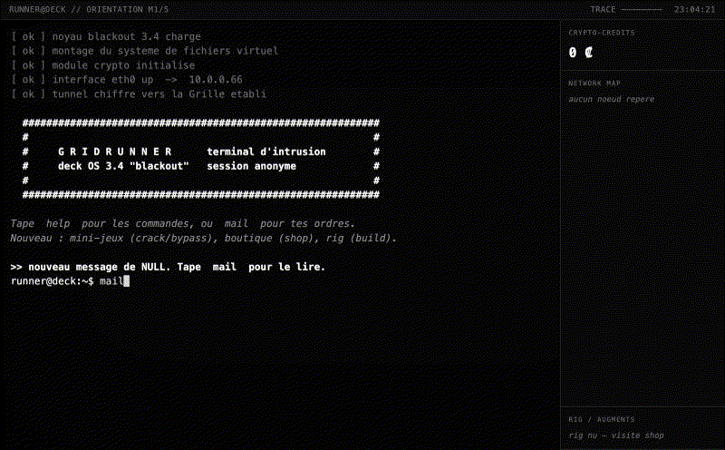

# 💻 GRIDRUNNER

**A hacker-terminal web game in the spirit of *Hacknet* and *Uplink*.**
You play a runner recruited by an anonymous entity, **NULL**, to break into the network of the mega-corp **Aegis Dynamics**, reach its internal mainframe and leak proof of a mass-surveillance programme, without leaving a trace.


**▶ Play it in your browser:** https://loogatoxx.github.io/gridrunner/ (the game text is in French)

🇫🇷 [Version française](README.fr.md)

<p align="center"></p>

Plain HTML / CSS / **JavaScript**, with zero dependencies and no build step. The art direction is brutalist: cold white on deep black, monospace, subtle scanlines.

## Play locally

```bash
open index.html              # or double-click it
# or, to avoid any cache issue:
python3 -m http.server 4173  # then http://localhost:4173
```

Type **`help`** for the command list and **`mail`** to read your first orders. Progress is saved automatically (`localStorage`). `reset` starts over.

## The campaign

| Mission | Name | What you learn |
|--------:|------|----------------|
| 1 | **ORIENTATION** | Find your way: `ls`, `cat`, `cd`, `pwd` |
| 2 | **RECON** | Map the network: `scan` (ports), `connect` (remote shell) |
| 3 | **ESCALATION** | `crack` (dictionary attack on a hash), `su`, `decrypt` |
| 4 | **CLEANUP** | Anti-forensics: read then `shred` logs, manage the **trace** |
| 5 | **ORACLE** | Put it all together: network **pivoting**, exfiltration, full wipe |

From mission 4 on, every action on a remote host fills a trace gauge. If it maxes out, it's **Game Over**: the run is lost, but credits and upgrades are kept.

## Rogue-like loop (v2.0)

- **Hacking mini-games** in an overlay: sequence memory, a hex grid, nodes to click in order, all against the clock. Failing spikes the trace.
- **Economy:** first intrusions pay a bounty, and `download` + `sell` turns files into crypto-credits.
- **Darknet Market** (`shop`): three random upgrades, such as *Ghost-Mask* (−30 % trace) or *Overclock CPU* (+20 % mini-game time).
- **Meta-progression:** credits and upgrades survive Game Over.

## Architecture

The code is split to be **readable and easy to study**. Every core module is wrapped in an IIFE and exposed on `window.HT` (browser) or `module.exports` (Node), so the *same* file runs in the game and in the tests.

```
js/core/
  VirtualFileSystem.js   object-oriented VFS: a tree of VfsNode, path resolution
  CommandParser.js       robust tokenizer (quotes, escapes, -la / --key=val flags), never throws
  StateMachine.js        generic FSM: only declared transitions, fail-fast
  Network.js             hosts, ports, auth, logs, pivoting
  PlayerBuild.js         upgrades as data, folded into effective stats
  Market.js · Minigame.js · world.js · CommandRegistry.js · GameEngine.js · commands.js
js/ui/
  Terminal.js · MinigameUI.js · AudioFX.js (Web Audio)
tests/run.js             self-test suite
```

**Guiding rule:** commands never mutate state directly. They validate arguments, call a method on the **engine**, then print. The engine alone owns the session stack, the FSM and the trace. As a result the logic can be tested without a DOM, and `CommandRegistry.execute()` wraps every command in a `try/catch`, so a buggy command can never crash the game loop.

## Tests

```bash
node tests/run.js
```

**102 assertions**: VFS, parser (with fuzzing), FSM, crypto, **a complete playthrough to victory**, trace, mini-games, market, economy, Game Over, and a barrage of absurd inputs to make sure **the terminal never crashes**.

## Design notes

- **IP addresses** come only from *documentation* ranges (RFC 5737 / RFC 1918). It's fiction.
- **The "crypto" is a deliberate toy** (dictionary hash, XOR) to illustrate the concepts. In real life you'd use SHA-256 through WebCrypto.

## How it was built

I built GRIDRUNNER with **Claude Code** from a brief I wrote: an OOP virtual file system, a state machine and a robust command parser. The prompt log is in [`historique_prompts.md`](historique_prompts.md) (in French).

## License

[MIT](LICENSE)
